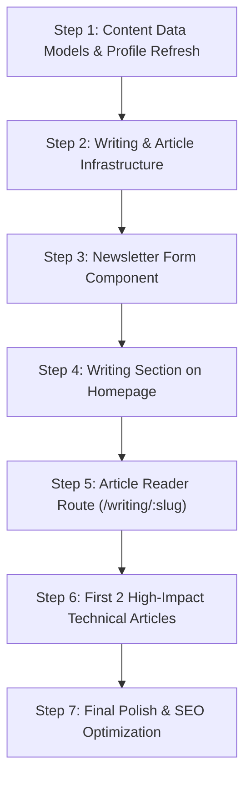

# Master Strategic Plan: High-Impact Software Engineering Portfolio & Newsletter Platform

**Target Engineer:** Antony Isaac Gayed — Senior .NET & Backend Software Engineer  
**Objective:** Transform the portfolio into a high-authority engineering platform that showcases deep backend expertise, proves production-grade impact, and builds an audience through a technical publication and newsletter.  
**Target Audience:** Engineering Managers, CTOs, Technical Recruiters, and Fellow Backend Developers.

---

## 1. Strategic Goals & Career Benefits

Why build this specific architecture instead of a generic portfolio?

| Core Feature / Section | Career & Business Benefit | Hiring Manager / Reader Reaction |
| :--- | :--- | :--- |
| **Hero with Live System Scope** | Immediate positioning as a specialized backend & distributed systems engineer. | *"This is not a junior generalist; this is an engineer who understands scalable backend systems."* |
| **Experience with Quantifiable Metrics** | Proves business impact, throughput gains, and production reliability. | *"He increased query throughput by 40% using CQRS and built tax integration middleware."* |
| **Architectural Case Studies** | Separates top 5% engineers from code monkeys by explaining *trade-offs, failure modes, and system design*. | *"He understands distributed consistency, caching trade-offs, and multi-tenant security."* |
| **Interactive Projects with Live Demos** | Immediate validation of full-stack competence (ASP.NET Core Web API + Angular). | *"Clean architecture, live running endpoints, well-documented code."* |
| **Technical Writing & Post Reader** | Demonstrates clear technical communication, knowledge sharing, and domain authority. | *"He can articulate complex systems, document architectural decisions, and mentor others."* |
| **Engineering Newsletter Integration** | Builds a persistent audience, long-term personal brand, and inbound opportunities. | *"Subscribed to get his breakdowns on .NET performance and Clean Architecture."* |

---

## 2. Platform Architecture: Portfolio + Publishing + Newsletter

```
┌────────────────────────────────────────────────────────────────────────┐
│                        Angular Frontend (SPA)                          │
├───────────────────┬───────────────────┬────────────────────────────────┤
│   Landing View    │  Article Index    │      Article Deep Dive         │
│   (Single Page)   │  (/writing)       │      (/writing/:slug)          │
│  - 01 Hero        │  - Filter by tags │  - Markdown / Article Reader   │
│  - 02 About       │  - Search         │  - Syntax Highlighted Code     │
│  - 03 Experience  │  - Newsletter CTA │  - Table of Contents           │
│  - 04 Projects    │                   │  - Newsletter Subscription Box │
│  - 05 Writing     │                   │  - Share & Discussion Links    │
│  - 06 Contact     │                   │                                │
└─────────┬─────────┴─────────┬─────────┴───────────────┬────────────────┘
          │                   │                         │
          ▼                   ▼                         ▼
┌──────────────────┐┌───────────────────────┐┌───────────────────────────┐
│ Local Content    ││ Newsletter Provider   ││ Static Assets & SEO       │
│ Data Layer       ││ (Substack / Buttondown││ - OpenGraph Meta Tags     │
│ - profile.ts     ││  / Beehiiv Embedded)  ││ - RSS Feed (feed.xml)     │
│ - articles.ts    ││ - Zero-backend signup ││ - CV Download (PDF)       │
│ - /assets/posts/ ││ - Automated delivery  ││                           │
└──────────────────┘└───────────────────────┘└───────────────────────────┘
```

---

## 3. Detailed Section Breakdown & Content Data Specification

### Section 01: Hero & Positioning
* **Objective:** Capture attention within 5 seconds with crisp technical identity and credentials.
* **Data Fields Required:**
  * **Full Name:** Antony Isaac Gayed
  * **Title / Headline:** Software Engineer — .NET & Backend Architecture
  * **Location & Availability:** Cairo, Egypt • Open to Remote & Relocation
  * **Years of Experience:** 3+ Years in Production Backend Engineering
  * **Primary Stack Badges:** C# • ASP.NET Core • Clean Architecture • EF Core • SQL Server • Redis
  * **Quick CTAs:** Download CV (`cv.pdf`), Read Articles (`#writing`), View Code (`GitHub`), Contact (`#contact`).

---

### Section 02: About & Engineering Philosophy
* **Objective:** Establish engineering values: Clean Architecture, defensive programming, performance optimization, and pragmatic system design.
* **Data Fields Required:**
  * **Bio Narrative:** Focus on building fault-tolerant APIs, multi-tenant architectures, and scalable transactional pipelines.
  * **Core Engineering Principles (3 Cards/Rows):**
    1. *Clean & Maintainable Architecture:* Strict separation of concerns, domain-driven boundaries, testability.
    2. *Performance by Design:* Indexed queries, AsNoTracking, split queries, Redis caching, CQRS segregation.
    3. *Defensive & Secure:* HMAC request verification, RBAC, tenant isolation, structured logging with Serilog.
  * **Education & Credentials:**
    * Information Technology Institute (ITI) — 9-Month Intensive .NET Full Stack Diploma.
    * Minya University — B.Sc. in Computers & Information.

---

### Section 03: Professional Experience (Production Track Record)
* **Objective:** Provide hard evidence of shipping enterprise systems with real metrics.
* **Data Fields Required:**
  1. **Cyrus (March 2023 – Present) | Software Engineer (.NET Backend)**
     * *Project A — ETA Middleware Integration System:*
       * Built centralized gateway integrating with the Egyptian Tax Authority portals for high-volume invoice processing.
       * Implemented HMAC signature verification and Quartz.NET automated scheduling workers.
       * Enforced endpoint rate limiting and Serilog structured telemetry.
     * *Project B — Retail Management System (RMS):*
       * Engineered modular monolithic backend with CQRS pattern, increasing heavy query throughput by **40%**.
       * Designed distributed Redis caching and background synchronization workers for offline-first store transactions.
     * *Project C — Portal & CRM Accountant System:*
       * Implemented multi-tenant Role-Based Access Control (RBAC) ensuring zero data cross-over.
       * Re-indexed schemas and optimized complex relational queries, reducing financial report generation times by **35%**.
  2. **Freelance (January 2023 – February 2023) | Software Engineer (.NET)**
     * *Financial Transfer Application Module:*
       * Engineered transactional procedures guaranteeing strict ACID atomicity during deposits and multi-account balance reconciliations.

---

### Section 04: Featured Engineering Projects & Case Studies
* **Objective:** Prove full-stack and architectural capabilities with accessible repositories and live demos.
* **Data Fields Required:**
  1. **Seafood Restaurant Multi-Branch System:**
     * *Stack:* Angular, ASP.NET Core Web API, EF Core (Code First), SQL Server.
     * *Key Highlights:* Real-time kitchen order dispatching, multi-branch inventory tracking, clean REST contracts.
     * *Links:* Frontend Repo, Backend Repo, Architecture Diagram.
  2. **Educational Courses Center Portal:**
     * *Stack:* ASP.NET MVC, C#, SQL Server, jQuery, Ajax, Sass.
     * *Key Highlights:* Academic repository hosting, student ledger tracking, role-based exam distributions.
     * *Links:* GitHub Repository.
  3. **High-Performance Distributed Cache & Rate Limiting Utility (Showcase):**
     * *Stack:* C#, Redis, Token Bucket Algorithm, ASP.NET Core Middleware.
     * *Key Highlights:* Clean reusable middleware for throttling API abuse with sliding window memory stores.

---

### Section 05: Technical Writing & Posts (The Engineering Blog)
* **Objective:** Demonstrate deep subject matter mastery, improve SEO, and establish yourself as an authority in .NET.
* **Initial High-Value Article Topics:**
  1. *"How We Increased Database Throughput by 40% Using CQRS & Read-Model Segregation in .NET"*
  2. *"Building a Multi-Tenant Tax Authority Integration Pipeline with Quartz.NET and Cryptographic HMAC"*
  3. *"The Pragmatic Guide to Clean Architecture in ASP.NET Core without Over-Engineering"*
  4. *"Preventing Tenant Leaks: Enforcing Global Query Filters & Auditing in EF Core"*
* **Post Metadata Contract:**
  ```ts
  export interface Article {
    slug: string;
    title: string;
    summary: string;
    publishedDate: string;
    readingTime: string;
    tags: string[];
    featured?: boolean;
    contentPath?: string; // Path to markdown file or embedded markdown content
    canonicalUrl?: string; // If syndicated on Substack or Medium
  }
  ```

---

### Section 06: Newsletter Integration ("The Pragmatic .NET Dispatch")
* **Objective:** Convert casual visitors into lifelong subscribers and professional contacts.
* **Implementation Plan:**
  * **Provider:** Substack, Beehiiv, or Buttondown (all provide free custom embed forms with zero maintenance).
  * **Placement:**
    1. Prominent signup card at the end of the `#writing` section on the homepage.
    2. Footer CTA across all pages.
    3. Dedicated subscription box at the bottom of every individual article reader view (`/writing/:slug`).
  * **Value Proposition Copy:**
    > *"Join developers receiving deep dives on ASP.NET Core, database tuning, Clean Architecture, and real-world backend architecture lessons. No spam, just engineering rigor."*

---

### Section 07: Contact & Network
* **Objective:** Remove all friction for recruiters and hiring managers to reach out.
* **Data Fields Required:**
  * Direct Email: `antonyisaacgayed@gmail.com`
  * Phone / WhatsApp: `+20 122 560 9831`
  * Social Links: LinkedIn, GitHub, HackerRank
  * Location: Cairo, Egypt (GMT+2)

---

## 4. Step-by-Step Implementation Roadmap



### Sprint 1: Data Contracts & Article Store
- [ ] Create `src/app/core/data/articles.ts` with structured metadata and preview excerpts.
- [ ] Update `src/app/core/data/profile.ts` with Antony's verified achievements, metrics, and project links.

### Sprint 2: Technical Writing & Reader Architecture
- [ ] Add Angular routing for `/writing` (archive) and `/writing/:slug` (full reader).
- [ ] Integrate lightweight Markdown renderer or HTML content parser with syntax highlighting (Prism.js / highlight.js for C# & SQL).
- [ ] Implement responsive article layout with typography matching the editorial magazine design system.

### Sprint 3: Newsletter Integration
- [ ] Create a reusable `NewsletterSignup` standalone component.
- [ ] Support direct integration with Substack / Buttondown / Beehiiv embed endpoints.
- [ ] Add success/error UX states with accessible validation.

### Sprint 4: Content Authoring & Seed Articles
- [ ] Author Article #1: *Optimizing EF Core and CQRS for High-Throughput Retail Backends*.
- [ ] Author Article #2: *HMAC Signature Verification & Multi-Tenant Middleware in ASP.NET Core*.

### Sprint 5: Verification & Launch
- [ ] Test mobile responsiveness, dark/light theme switching on code blocks.
- [ ] Verify fast page load speeds (Lighthouse score 95+).
- [ ] Verify social share cards (OpenGraph metadata for articles).

